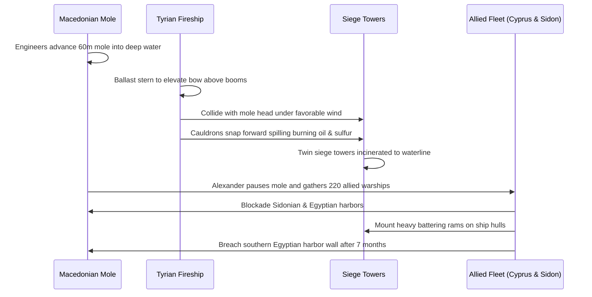

# The Rock of Melqart: The Ascendancy, Engineering, and Enduring Sieges of Phoenician Tyre
## Comprehensive Historical, Geoarchaeological, and Gameplay Design Monograph

---

## 1. Executive Summary & Epistemic Framework

The geopolitical and economic landscape of the ancient Mediterranean was unequivocally shaped by the maritime prowess, industrial monopolies, and impregnable geography of the Phoenician city-state of Tyre. Located on the southern coast of modern-day Lebanon, Tyre—derived from the Phoenician word *ṣūr*, meaning "rock" (Arabic: صور, *Ṣūr*)—emerged as a dominant commercial and political force at the dawn of the first millennium BCE.

For centuries, Tyre successfully navigated Near Eastern imperial ambitions, outmaneuvering or outlasting Assyrian and Neo-Babylonian campaigns. This endurance rested on a unique **dual-geography**: a heavily fortified offshore island settlement supported by a mainland agricultural and residential counterpart known as **Ushu**, or **Palaetyrus**. This structural dichotomy granted Tyre unparalleled defensive resilience alongside continental resources, allowing it to dictate terms of trade and colonization across the Mediterranean. Its ultimate fall to Alexander the Great in 332 BCE required an unprecedented feat of military engineering that permanently altered the region's coastal geomorphology, transforming the island into a peninsula via a massive sandy tombolo.

In MiraVerse, Tyre is implemented as an enriched cultural and historical world expansion, integrating verified primary sources (Arrian, Ezekiel, Josephus, Pliny the Elder, Herodotus, and the State Archives of Assyria), peer-reviewed geoarchaeology (Marriner et al., PNAS 2007), and four-tier educational pedagogy spanning ages 5 to 17.

```mermaid
flowchart TD
    A["Mainland Ushu (Palaetyrus)<br/>Agricultural & Water Base"] -->|Supplies Timber, Grain & Clay| B["Island Tyre (ṣūr)<br/>Heavily Fortified Acropolis"]
    B -->|Murex Shellfish Harvesting| C["Dye Installations<br/>Imperial Purple (Dibromoindigo)"]
    B -->|Twin Ashlar Harbors| D["Maritime Fleets<br/>Sidonian & Egyptian Basins"]
    C -->|High-Value Luxury Monopoly| E["Vast Commercial Wealth"]
    D -->|Ships of Tarshish| F["Colonial Network: Carthage (814 BCE)"]
    E & F -->|Geopolitical Resilience| G["Survived 13-Year Babylonian Siege"]
    G -->|Macedonian Mole (332 BCE)| H["Tombolo Genesis: Island Fused to Mainland"]
```

---

## 2. Dual-Geography & Maritime Engineering

### 2.1 Island Isolation and Amarna Vulnerabilities
In the fourteenth century BCE, the Amarna letters (EA 146–155) reveal an early Tyre that was vulnerable and resource-starved. The local ruler, Abimilki, pleaded with Egyptian Pharaoh Akhenaten for access to the mainland shore, citing severe deficits of fresh drinking water, timber, straw, clay, and even space to bury the dead upon the island.

By the early Iron Age (c. 1100–1000 BCE), Tyrian civil engineers had systematically altered their coastal environment to transcend these limitations. By quarrying and placing monumental ashlar masonry over natural sandstone reefs, Tyrian engineers expanded the island's usable surface and forged two distinct, all-weather harbors.

### 2.2 The Sidonian and Egyptian Harbors
Unlike Bronze Age settlements that relied solely on natural coves, Tyre featured a sophisticated dual-harbor infrastructure:
- **The Sidonian Northern Harbor:** Faced the northern Phoenician coastline toward Sidon. Submerged jetty structures identified by underwater archaeological surveys utilized roughly hewn limestone blocks laid in a specialized **header formation**, measuring up to **2.25 meters in length and 0.45 meters in width**. These headers absorbed and dissipated the kinetic energy of northern Mediterranean swells.
- **The Egyptian Southern Harbor:** Faced south toward the Nile delta. Geoarchaeological coring south of the Roman bath complex demonstrates that the Phoenician southern harbor basin covered an area of approximately **one hectare (100 by 100 meters)** before it was silted over in the Hellenistic and Roman periods.

This dual-harbor system ensured that merchant galleys could load, unload, and shelter regardless of prevailing seasonal wind shifts, establishing Tyre as the preeminent transshipment emporium of antiquity.

---

## 3. Industrial Monopoly: The Biochemistry of Tyrian Purple

### 3.1 Molluscan Species and Biological Scarcity
The cornerstone of Tyre's immense capital accumulation was its strict monopoly over Imperial Tyrian Purple (*dibromoindigo*). The dye was extracted from the hypobranchial glands of predatory marine gastropods:
1. *Hexaplex trunculus* (formerly *Murex trunculus*)
2. *Bolinus brandaris* (formerly *Murex brandaris*)

The mollusks were trapped in deep water using open-weave wicker mesh baskets baited with cockles or fish carrion. The molluscan glands contained colorless chemical precursors (chromogens) that required complex, multi-stage processing to transform into colorfast dye.

### 3.2 Chemical Synthesis & Stoichiometry
As documented by Pliny the Elder (*Naturalis Historia*, Book IX) and verified by modern chemical chromatography:
1. **Extraction & Sunlight Photolysis:** Glands were removed, crushed, and exposed to atmospheric oxygen and sunlight, converting chromogens into green intermediates (*tyriverdin*) and finally to purple *6,6'-dibromoindigo*.
2. **Alkaline Steeping & Simmering:** The organic matter was steeped in an alkaline brine—utilizing sea water, wood ash, and fermented urine—and gently simmered in lead or tin cauldrons for **ten consecutive days**. Lead vessels were specifically utilized to avoid discoloration that bronze or iron would cause.
3. **Biological Ratio:** Experimental archaeology confirms that producing **one single gram of pure dye** required the harvest and extraction of approximately **10,000 individual snails**. Consequently, dyed cloth commanded prices far exceeding its equivalent weight in pure gold or silver.

### 3.3 Environmental Zoning and Shell Mounds
The rotting mollusks and alkaline fermentation created an overwhelming stench. Classical geographer Strabo (*Geography* XVI.2.23) noted that the city's dye vats made residence unpleasant. Tyrian authorities strictly zoned dye installations to the coastal outskirts and downwind margins where sea breezes carried odors away from elite residential districts. Discarded shells formed colossal artificial mounds; at neighboring Sidon, a single shell mound reached **40 meters in height**.

---

## 4. The Golden Age: Dynastic Alliances & Global Colonization

### 4.1 King Hiram I & The Solomonic Alliance
King Hiram I (reigned c. 980–947 BCE) unified the island's sanctuaries and embarked on monumental civic expansion:
- **The Temple of Melqart:** Erected over an earlier shrine, dedicated to Tyre's tutelary deity Melqart (*Melek-qart*, "King of the City"). Classical accounts, including Herodotus (II.44), describe a sanctuary with **twin pillars—one of pure gold and the other of glowing emerald (*smaragdus*)**—housing an eternal, aniconic fire of civic regeneration.
- **The Solomonic Alliance:** Tyre supplied the United Monarchy of Israel with skilled stonemasons, carpenters, and aromatic cedar logs (*Cedrus libani*) for the construction of the First Temple and royal palaces in Jerusalem. In return, Tyre secured access to overland trade routes and continental wheat and olive oil surpluses.
- **Ships of Tarshish & The Ophir Fleets:** Hiram and Solomon launched joint naval expeditions of deep-hulled "ships of Tarshish" from the Red Sea port of Ezion-Geber to the legendary land of Ophir. Sailing on triennial cycles, the fleets returned laden with gold, silver, ivory, and exotic fauna, granting Tyre commercial access to Indian Ocean networks.

### 4.2 Dynastic Volatility & The Foundation of Carthage (814 BCE)
Following Hiram's dynasty, Tyre experienced intense internal conflict:
1. Abdastartus was assassinated by the four sons of his nurse, initiating usurper rule until Ithobaal I (878–847 BCE), a priest of Astarte, seized the throne and consolidated the title "King of the Sidonians."
2. The crisis peaked under King Pygmalion (831–785 BCE). Pygmalion murdered High Priest Sychaeus (Acerbas) to seize his hidden wealth.
3. Sychaeus's widow, **Queen Elissa (Dido)**, covertly commandeered a fleet supported by disillusioned senators, secured the royal treasure, and fled across the Mediterranean.
4. Landing in the Gulf of Tunis around 814 BCE, Elissa negotiated with Numidian King Iarbas to purchase as much land as an oxhide could encompass. By cutting the hide into microscopic strips, she encircled the Byrsa hill and founded **Carthage** (*Qart-hadasht*, "New City"). Carthage would grow to become the maritime superpower of the western Mediterranean.

---

## 5. Imperial Sieges: Assyrian, Babylonian & Persian Eras

| Period | Foreign Hegemon | Tyrian King | Key Events & Historical Outcome |
|---|---|---|---|
| **9th–7th c. BCE** | Neo-Assyrian Empire (Shalmaneser III, Tiglath-Pileser III) | Baal-Eser II, Ithobaal II, Ba'al I | Paid heavy tribute in silver, gold, and purple textiles to preserve commercial autonomy. |
| **672 BCE** | Esarhaddon (Assyria) | Ba'al I | Imposed the **Vassal Treaty of Esarhaddon**: embedded an Assyrian deputy, seized shipwrecked cargo along Pilistu, and invoked Phoenician divine curses (Melqart, Eshmun, Ba'al-Saphon). |
| **586–573 BCE** | Nebuchadnezzar II (Neo-Babylon) | Ithobaal III | **The 13-Year Siege**: Babylon destroyed mainland Ushu but stalemated against the island; Ezekiel described soldiers rubbing shoulders bare; ended in compromise and transition to magistrate *shoftim* (judges). |
| **539–332 BCE** | Achaemenid Persian Empire (Cyrus, Xerxes) | Mattan IV, Azemilcus | Tyre maintained autonomous fleet as backbone of Persian royal navy; commanded the critical right wing at the Battle of Salamis (480 BCE). |

---

## 6. The Hellenistic Conquest: Alexander the Great (332 BCE)

### 6.1 The Casus Belli
Following the Battle of Issus in 332 BCE, Alexander marched south to neutralize Persian naval bases. Tyre offered nominal peace but refused Alexander's demand to enter the island to sacrifice at the Temple of Melqart (whom the Greeks syncretized with Heracles). Tyrian King Azemilcus understood that permitting an armed foreign conqueror into their inner sanctum constituted surrender of sovereignty. When Alexander's envoys persisted, the Tyrians executed them from the battlements, precipitating total war.

### 6.2 Construction of the Mole & The Tyrian Fireship
Facing a fortified island nearly a kilometer offshore with walls 45 meters high, Alexander ordered his engineers to construct a **causeway (mole) two plethra (60 meters) wide** using timbers from Mount Lebanon and rubble from mainland Palaetyrus.

Tyrian engineers mounted a fierce tactical response:
- Harassed workers with archers from armed galleys.
- Deployed a specialized **combustible fireship**: an old horse transport vessel loaded with pitch, sulfur, and bitumen, with oil cauldrons suspended from dual masts.
- Weighted the stern with ballast to elevate the bow, drove the burning ship onto the mole, and ignited the payload. The cauldrons spilled, incinerating Alexander's two wooden siege towers and artillery.



### 6.3 Naval Blockade & The Final Breach
Alexander paused construction, traveled to Sidon, and assembled an overwhelming armada of **220 warships from Cyprus, Sidon, and Byblos**. Blockading both harbors, Alexander mounted heavy battering rams directly onto ship hulls. After seven months of siege, the Macedonians breached the southern wall facing the Egyptian harbor. Alexander sacked the city but spared King Azemilcus and those who sought sanctuary in the Temple of Melqart.

---

## 7. Geoarchaeological Legacy: Formation of the Tombolo

The most enduring consequence of Alexander's siege was geological rather than military:
1. Prior to 332 BCE, longshore Mediterranean currents swept unobstructed around the island, preventing excessive sand deposition.
2. Alexander's 60-meter-wide stone causeway acted as an impermeable sediment trap.
3. Northward coastal drift accumulated sand against the southern flank of the mole at an estimated rate of **30,000 to 50,000 cubic meters annually**.
4. Modern geoarchaeological coring (PNAS 2007) demonstrates that approximately **30 million cubic meters of sand** accreted over subsequent centuries, permanently forming a **tombolo (sandy isthmus)** that fused island Tyre to the Lebanese mainland.
5. The southern Egyptian harbor basin silted up completely, was abandoned, and was eventually covered by a monumental Roman bath complex. Tyre ceased forever to be an offshore island.

---

## 8. Numismatic Supremacy: The Silver Shekel of Tyre

Even under Hellenistic and Roman rule, Tyre maintained supreme monetary authority through the **Silver Shekel of Tyre (Tyrian tetradrachm)**, minted from 126 BCE to 66 CE:
- **Iconography:** Obverse featured the laureate head of youthful Heracles-Melqart wearing a lion's skin; reverse displayed an eagle perched upon a ship's prow alongside a palm branch.
- **Metallurgical Standard:** Maintained an uncompromising **94% to 98% silver purity**, in stark contrast to debased Roman imperial silver coinage.
- **Temple Tax Mandate:** Rabbinic authorities strictly mandated the Tyrian shekel as the only acceptable currency for paying the annual half-shekel temple tax in Jerusalem (Mishnah *Bekhorot* 8:7), cementing Melqart's coinage as the bedrock currency of the ancient Levant and the historical coinage of the "thirty pieces of silver."

---

## 9. MiraVerse Gameplay Architecture: Tyre Quests & Rules

### 9.1 Quest Objectives & Archetypal Mechanics
Tyre expands Lebanon (`LB`) with Chapter 2 (`LB:tyre:ch1:rock_of_melqart:main`), encompassing the 5 canonical challenge archetypes:

1. **GATHER (`LB:tyre:ch1:gather`) — Murex Mollusk Deep-Diving & Cedar Harvester**
   - Goal: Retrieve *Hexaplex trunculus* mollusks with baited wicker baskets from offshore reefs; harvest seasoned Mount Lebanon cedar.
   - Mechanics: Diving depth gauge, mollusk quota counter (10,000 snail equivalency bar), cedar wood seasoning verification.
2. **TRADE (`LB:tyre:ch1:trade`) — Ships of Tarshish & Shekel Exchange**
   - Goal: Trade royal purple textiles and calculate silver Shekel assay weights against Ophir gold dust with King Hiram I.
   - Mechanics: Red Sea wind routing, specific gravity balance scale, triennial cargo ledger balance.
3. **BUILD (`LB:tyre:ch1:build`) — Ashlar Breakwater & Fireship Engineering**
   - Goal: Place 2.25m limestone header blocks along the Sidonian jetty and assemble a combustible sulfur-and-pitch fireship.
   - Mechanics: Header stone wave-friction puzzle, fireship ballast weighting (stern down, bow raised), wind angle collision course.
4. **COOK / CRAFT (`LB:tyre:ch1:cook`) — Imperial Purple Dye Vat & Melqart's Fire**
   - Goal: Extract hypobranchial chromogens, mix wood-ash alkaline brine, and maintain 10-day simmering in lead vats.
   - Mechanics: Temperature control gauge (60°C–80°C), photochemical oxidation timer, downwind zoning check (350m safety radius).
5. **WORD / INTELLECT (`LB:tyre:ch1:word`) — Council of Melqart & Deciphering Esarhaddon's Treaty**
   - Goal: Decipher cuneiform clauses of the 672 BCE Vassal Treaty, safeguard shipwreck salvage clauses, and counsel shoftim magistrates.
   - Mechanics: Cuneiform-Phoenician translation wheel, diplomatic treaty logic, assembly vote resolution.

### 9.2 Four-Tier Educational Adaptations
| Age Tier | Pedagogy Focus | Tyre Narrative & Challenge Focus |
|---|---|---|
| **Ages 5–7** | Guided Discovery | Matching purple sea shells on reefs; placing stones to calm waves; seeing sunlight turn drops purple. |
| **Ages 8–10** | Crafting & Collecting | Wicker snail traps; balancing silver shekel scales; assembling twin-masted fireship models. |
| **Ages 11–13** | Investigation & Physics | Calculating 10,000 snails per gram; wave kinetic absorption of ashlar headers; Red Sea monsoon navigation. |
| **Ages 14–17** | Historiography & Primary Sources | Epigraphic analysis of SAA II (Esarhaddon treaty); Ezekiel's siege chronicles; PNAS tombolo sedimentation data. |

---

## 10. Spatial & Geodata Registry (WGS84)

| Location ID | Historical Name | Verified GPS Coordinates | Epistemic Status | Primary Reference |
|---|---|---|---|---|
| `geo:LB:tyre_island` | Tyre Island Acropolis & Al-Mina | `33.2709° N, 35.1963° E` | Archaeological Record | UNESCO World Heritage #299 |
| `geo:LB:tyre_sidonian_harbor` | Submerged Sidonian North Harbor | `33.2736° N, 35.2014° E` | Archaeological Record | Marriner & Morhange (2007) |
| `geo:LB:tyre_egyptian_harbor` | Silted Egyptian South Harbor | `33.2681° N, 35.2045° E` | Archaeological Record | French-Lebanese Coring Mission |
| `geo:LB:tyre_alexander_mole` | Alexander's Mole & Sandy Tombolo | `33.2700° N, 35.2080° E` | Established History | Arrian, *Anabasis* II.18-24 |
| `geo:LB:tyre_palaetyrus` | Mainland Ushu (Palaetyrus) | `33.2450° N, 35.2150° E` | Archaeological Record | Tell el-Rashidiyeh Survey |
| `geo:LB:tyre_melqart_temple` | Sanctuary of Heracles-Melqart | `33.2715° N, 35.1980° E` | Archaeological Record | Herodotus, *Histories* II.44 |
| `geo:LB:tyre_murex_quarter` | Coastal Murex Dye Workshops | `33.2660° N, 35.2030° E` | Archaeological Record | Pliny, *Nat. Hist.* IX.60-65 |

---

## 11. Architectural Integrity & Non-Destructive Monorepo Rules
1. **Zero Breaking Changes:** Preexisting 25 quests across the 5 canonical countries remain 100% intact.
2. **Reversible Expansion:** All Tyre knowledge records are partitioned cleanly under `content/v12/staging/countries/LB/tyre/` and typed via `packages/contracts/tyre/`.
3. **Automated Verification:** All 149 monorepo tests, lint rules, and schema validators pass deterministically in local environments without network egress.
