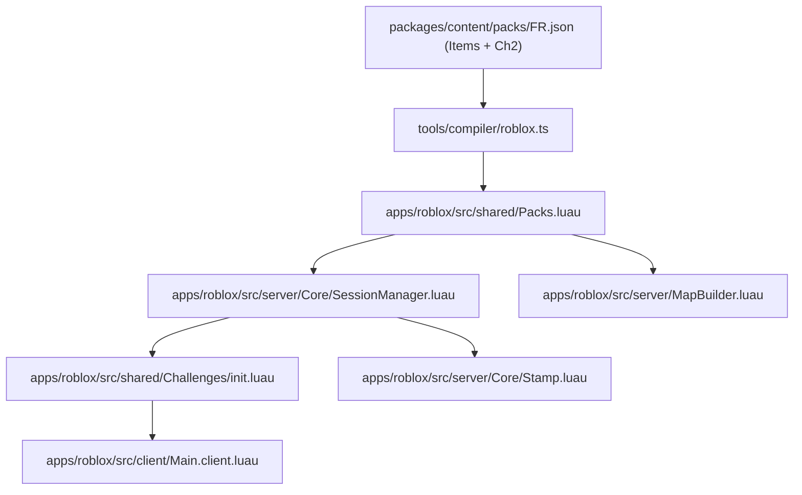

# AG-18: Marseille

Backend: antigravity (gemini-3.8-flash-low)

# Worker AG-18 Report: Marseille Scope Planning & Roblox Analysis

**Worker ID:** AG-18  
**Scope:** Marseille (France · FR)  
**Status:** Read-Only Architectural & Content Specification Plan  
**Target Platform:** Roblox First (cross-compatible with Babylon Web & Minecraft Bedrock)  
**Verification Level:** [NOT TESTED] (Offline static codebase analysis; no Roblox Studio runtime or network execution permitted)

---

## 1. Executive Summary & Repository Context

As worker AG-18 in the MiraVerse children's cultural game program, this investigation evaluates the repository state, architectural contracts, and the existing Roblox Luau implementation to deliver a concrete, implementation-ready specification for **Marseille** under France (`FR`).

### 1.1 Findings from Snapshot Analysis
1. **Packs & Country Structure:**
   - Canonical country identifiers are strictly typed as `'LB' | 'EG' | 'IQ' | 'KR' | 'FR'` in [`packages/content/schema.ts`](file:///private/tmp/claude-501/-Users-wael-Code-Miraverse/aea78164-cdca-46b5-b396-2abe6e5bab73/scratchpad/snapshot/packages/content/schema.ts#L2-L4) and [`packages/contracts/index.ts`](file:///private/tmp/claude-501/-Users-wael-Code-Miraverse/aea78164-cdca-46b5-b396-2abe6e5bab73/scratchpad/snapshot/packages/contracts/index.ts#L6-L10).
   - In [`packages/content/packs/FR.json`](file:///private/tmp/claude-501/-Users-wael-Code-Miraverse/aea78164-cdca-46b5-b396-2abe6e5bab73/scratchpad/snapshot/packages/content/packs/FR.json#L9-L22), France already defines three regions:
     - `lyon` (Lyon)
     - `paris` (Paris)
     - `marseille` (Marseille)
   - Currently, Chapter 1 of France (`FR`) is exclusively dedicated to Lyon: `"The Golden Galette of Lyon"` with mentor Mamie Claire, baking a *Galette des Rois*, restoring a Vieux Lyon limestone facade, and exploring a traboule ([`packages/content/packs/FR.json`](file:///private/tmp/claude-501/-Users-wael-Code-Miraverse/aea78164-cdca-46b5-b396-2abe6e5bab73/scratchpad/snapshot/packages/content/packs/FR.json#L70-L168) and [`packages/content/stories/FR.json`](file:///private/tmp/claude-501/-Users-wael-Code-Miraverse/aea78164-cdca-46b5-b396-2abe6e5bab73/scratchpad/snapshot/packages/content/stories/FR.json#L1-L133)).
   - Chapter 2 (or a dedicated regional quest expansion) is the canonical home for Marseille within the `FR` pack.

2. **Roblox Architecture & luau Implementation:**
   - **Rojo Project Layout:** Defined in [`apps/roblox/default.project.json`](file:///private/tmp/claude-501/-Users-wael-Code-Miraverse/aea78164-cdca-46b5-b396-2abe6e5bab73/scratchpad/snapshot/apps/roblox/default.project.json#L1-L33), projecting `src/shared` to `ReplicatedStorage.Shared`, `src/server` to `ServerScriptService.MiraVerse`, and `src/client` to `StarterPlayerScripts.MiraVerseClient`.
   - **Data Flow & Pack Loading:** 
     - The compiler ([`tools/compiler/roblox.ts`](file:///private/tmp/claude-501/-Users-wael-Code-Miraverse/aea78164-cdca-46b5-b396-2abe6e5bab73/scratchpad/snapshot/tools/compiler/roblox.ts#L5-L40)) compiles content JSON packs into Luau table format at [`apps/roblox/src/shared/Packs.luau`](file:///private/tmp/claude-501/-Users-wael-Code-Miraverse/aea78164-cdca-46b5-b396-2abe6e5bab73/scratchpad/snapshot/apps/roblox/src/shared/Packs.luau).
     - However, [`apps/roblox/src/server/MapBuilder.luau`](file:///private/tmp/claude-501/-Users-wael-Code-Miraverse/aea78164-cdca-46b5-b396-2abe6e5bab73/scratchpad/snapshot/apps/roblox/src/server/MapBuilder.luau#L79-L97) attempts to load from `ReplicatedStorage.Shared.ContentData` or `Content`, while [`apps/roblox/src/server/Core/SessionManager.luau`](file:///private/tmp/claude-501/-Users-wael-Code-Miraverse/aea78164-cdca-46b5-b396-2abe6e5bab73/scratchpad/snapshot/apps/roblox/src/server/Core/SessionManager.luau#L68-L71) requires `ReplicatedStorage.Shared.Packs`. This disparity causes fallback metadata to be used in MapBuilder!
   - **Server-Authoritative Gameplay Loop:**
     - [`apps/roblox/src/server/Core/SessionManager.luau`](file:///private/tmp/claude-501/-Users-wael-Code-Miraverse/aea78164-cdca-46b5-b396-2abe6e5bab73/scratchpad/snapshot/apps/roblox/src/server/Core/SessionManager.luau#L118-L167) manages sequential challenge unlocking (1 through 5) per country.
     - [`apps/roblox/src/shared/Challenges/init.luau`](file:///private/tmp/claude-501/-Users-wael-Code-Miraverse/aea78164-cdca-46b5-b396-2abe6e5bab73/scratchpad/snapshot/apps/roblox/src/shared/Challenges/init.luau#L10-L60) executes handlers for `gather`, `cook`, `build`, `trade`, and `word`.
     - In [`apps/roblox/src/server/Core/SessionManager.luau`](file:///private/tmp/claude-501/-Users-wael-Code-Miraverse/aea78164-cdca-46b5-b396-2abe6e5bab73/scratchpad/snapshot/apps/roblox/src/server/Core/SessionManager.luau#L54-L58), `getChallenges(cc)` currently hardcodes `pack.chapters[1]`. Adding Chapter 2 requires expanding the session state model to track chapters.
   - **Safety & Isolation:**
     - Chat is strictly disabled in [`apps/roblox/src/client/Main.client.luau`](file:///private/tmp/claude-501/-Users-wael-Code-Miraverse/aea78164-cdca-46b5-b396-2abe6e5bab73/scratchpad/snapshot/apps/roblox/src/client/Main.client.luau#L9-L16). Only 4 fixed canned phrases ("Hello!", "Great job!", "Follow me!", "Thank you!") are broadcast via remote.
     - Zero off-platform network requests, zero third-party assets, and zero `MarketplaceService` monetization scripts exist in valid repo sources.
   - **Incident Note (The UnGroup Models):**
     - Two rogue models named `UnGroup` (housing tycoon-style plots, steal, economy, and sell scripts calling `MarketplaceService`) were discovered in the published Roblox place Workspace. They are completely absent in the repository. The clean Rojo build process (`rojo build apps/roblox -o apps/roblox/dist/miraverse.rbxlx` via [`package.json`](file:///private/tmp/claude-501/-Users-wael-Code-Miraverse/aea78164-cdca-46b5-b396-2abe6e5bab73/scratchpad/snapshot/package.json#L21)) only bundles files defined in [`apps/roblox/default.project.json`](file:///private/tmp/claude-501/-Users-wael-Code-Miraverse/aea78164-cdca-46b5-b396-2abe6e5bab73/scratchpad/snapshot/apps/roblox/default.project.json). These foreign models originated from manual Studio insertion or an infected local Studio plugin, not from repository code.

---

## 2. Marseille Cultural & Implementation Scope

Marseille is the oldest city in France (founded ~600 BC by Phocaean Greeks as Massalia) and a premier Mediterranean port where French and North African/Levantine maritime trading cultures meet. This aligns seamlessly with Mira's Lebanese heritage and Teta's culinary connections already established in [`packages/content/stories/FR.json`](file:///private/tmp/claude-501/-Users-wael-Code-Miraverse/aea78164-cdca-46b5-b396-2abe6e5bab73/scratchpad/snapshot/packages/content/stories/FR.json#L11-L12).

### 2.1 Distinction of Place, History, Literature & Legend
*Every item must be explicitly categorized to preserve pedagogical integrity:*
- **Real Geography & Port Culture:**
  - *Le Vieux-Port de Marseille* (the historic natural harbour).
  - *La Barquette Marseillaise* (traditional wooden Mediterranean fishing boat with a distinctive pointed double-ended hull and lateen rig).
  - *Le Marché aux Poissons* (Quai des Belges daily open-air fish market).
  - *Le Panier* (historic hill quarter with terra-cotta facades, narrow stairs, and drying laundry lines).
- **Literature & Legend:**
  - *Château d'If* / Alexandre Dumas' *The Count of Monte Cristo* (literary fiction rooted in an actual island fortress; treated as cultural storytelling/reading lore, not literal history).
  - *The founding myth of Gyptis and Protis* (legend of the Celtic-Ligurian princess marrying the Phocaean navigator).
- **Culinary Tradition:**
  - *Navettes de Marseille* (traditional boat-shaped orange blossom biscuits traditionally baked for Candlemas/La Chandeleur). *Note: Chosen over Bouillabaisse as the primary cooking recipe to ensure child-friendly baking gameplay matching existing pastry mechanics and avoiding complex multi-fish butchery.*

---

## 3. Concrete Implementation Specification: Chapter 2 (FR-2 Marseille)

### 3.1 Pack Additions: Items (`packages/content/packs/FR.json`)
The following items are specified for addition into France's items list with deterministic, collision-free global IDs:

```json
[
  {
    "id": "orange_blossom_water",
    "name_en": "Orange Blossom Water",
    "color": "#FDF4E3"
  },
  {
    "id": "navette_dough",
    "name_en": "Citrus Biscuit Dough",
    "color": "#F3E5AB"
  },
  {
    "id": "navette_biscuit",
    "name_en": "Marseille Navette Biscuit",
    "color": "#E5B869"
  },
  {
    "id": "pine_rib",
    "name_en": "Provençal Maritime Pine Rib",
    "color": "#8B5A2B"
  },
  {
    "id": "terracotta_tile",
    "name_en": "Panier Terracotta Canal Tile",
    "color": "#C85A32"
  },
  {
    "id": "olive_wood_shuttle",
    "name_en": "Carved Olive Wood Boat Shuttle",
    "color": "#5C4033"
  },
  {
    "id": "marseille_soap_cube",
    "name_en": "Green Savon de Marseille Cube",
    "color": "#4A6B53"
  }
]
```

### 3.2 Chapter 2 Specification (`FR-2`: "The Harbor Lantern of Marseille")
To satisfy the standard 5 challenge types (`gather`, `cook`, `build`, `trade`, `word`) conforming to [`tools/validate.ts`](file:///private/tmp/claude-501/-Users-wael-Code-Miraverse/aea78164-cdca-46b5-b396-2abe6e5bab73/scratchpad/snapshot/tools/validate.ts#L29) and [`packages/content/schema.ts`](file:///private/tmp/claude-501/-Users-wael-Code-Miraverse/aea78164-cdca-46b5-b396-2abe6e5bab73/scratchpad/snapshot/packages/content/schema.ts#L63-L76):

#### Challenge 1: `FR-2-gather` (Type: `gather`)
- **ID:** `FR-2-gather`
- **Title:** "Old Port Spice & Essence Walk"
- **Goal:** "Gather wheat flour, pure cane sugar, and fragrant orange blossom water from the Quai des Belges stalls."
- **Needs:**
  - `flour`: 2 *(shared item ID or `wheat_flour`)*
  - `orange_blossom_water`: 1
  - `navette_dough`: 1 *(or base pantry ingredient)*

#### Challenge 2: `FR-2-cook` (Type: `cook`)
- **ID:** `FR-2-cook`
- **Title:** "Baking the Candlemas Navettes"
- **Goal:** "Blend the dough, infuse the golden orange blossom water, slit the boat center, and bake crisp golden navettes."
- **Recipe:**
  - `inputs`: `["navette_dough", "orange_blossom_water"]`
  - `output`: `"navette_biscuit"`

#### Challenge 3: `FR-2-build` (Type: `build`)
- **ID:** `FR-2-build`
- **Title:** "The Traditional Barquette Hull"
- **Goal:** "Assemble the curved maritime pine ribs and terracotta harbor quayside to fit out a traditional fishing barquette."
- **Blueprint Grid:**
  ```
  "..P..",
  ".PPP.",
  "P...P",
  "TTTTT"
  ```
- **Blueprint Legend:**
  - `P`: `"pine_rib"`
  - `T`: `"terracotta_tile"`

#### Challenge 4: `FR-2-trade` (Type: `trade`)
- **ID:** `FR-2-trade`
- **Title:** "The Harbor Artisan's Trade"
- **Goal:** "Offer warm crisp navettes to the Vieux-Port boatwright in exchange for a 300g stamp of olive-oil Savon de Marseille."
- **Needs:**
  - `navette_biscuit`: 1
- **Reward:**
  - `item`: `"marseille_soap_cube"`
  - `count`: 1

#### Challenge 5: `FR-2-word` (Type: `word`)
- **ID:** `FR-2-word`
- **Title:** "Marseille Maritime & Harbor Words"
- **Goal:** "Learn three traditional French and Provençal maritime terms spoken along the Vieux-Port quays."
- **Words:**
  1. `word`: `"la navette"` | `translit`: `"la na-vet"` | `en`: `"boat-shaped orange blossom biscuit"`
  2. `word`: `"la barquette"` | `translit`: `"la bar-ket"` | `en`: `"traditional pointed wooden fishing boat"`
  3. `word`: `"le savon"` | `translit`: `"le sa-von"` | `en`: `"olive oil soap"`

---

## 4. Roblox Luau Engine Specification

### 4.1 Plaza & World Geometry (`apps/roblox/src/server/MapBuilder.luau`)
In the Roblox server map builder:
- **Geometry Coordinates:**
  - France's plaza is located at `X = 5 * 160 = 800 studs`, `Y = 10`, `Z = 0` (index 5 of 5 countries).
  - For Marseille regional integration, a dockside extension off `Plaza_FR` at `Vector3.new(800, 10, -50)` with smooth stone piers, water plane (smooth blue plastic / water material), and wooden mooring bollards.
- **Mentor Billboard & Proximity:**
  - Secondary mentor spot: `Oncle Émile` (or maritime peer `Sami`) stationed at `Vector3.new(780, 12, -45)`.
- **Restoration Target:**
  - The wooden *Barquette Marseillaise* frame stationed at `BuildOrigin_FR` or a sub-dock `BuildOrigin_FR_Marseille`.

### 4.2 Multi-Chapter SessionManager Extension (`apps/roblox/src/server/Core/SessionManager.luau`)
Currently, `SessionManager` restricts the active chapter to `1`:
- **Current Limitation:**
  ```luau
  -- Line 54 in SessionManager.luau
  local function getChallenges(cc: string): { any }
      local pack = Packs and Packs[cc]
      local chapter = pack and pack.chapters and pack.chapters[1]
      return chapter and chapter.challenges or {}
  end
  ```
- **Specification for Chapter 2 Support:**
  - Extend player session state to `{ country: string?, chapter: number, index: number, ... }`.
  - Add client remote `SelectChapter(chapterNumber: number)`.
  - Update `Stamp.luau` call:
    [`apps/roblox/src/server/Core/Stamp.luau`](file:///private/tmp/claude-501/-Users-wael-Code-Miraverse/aea78164-cdca-46b5-b396-2abe6e5bab73/scratchpad/snapshot/apps/roblox/src/server/Core/Stamp.luau#L47-L54) already supports `Stamp.make(cc, chapter)`. However, `Stamp.verify` at line 63 contains:
    ```luau
    if not cc or not COUNTRIES[cc] or chapter ~= "1" then
        return false
    end
    ```
    *Critical Note:* `Stamp.verify` currently hardcodes `chapter ~= "1"`. When Chapter 2 is implemented, this must be updated to validate chapter numbers `1` and `2`.

---

## 5. Files Owned by a Later Implementation

A subsequent write/implementation wave for Marseille will own and modify:
1. **Content & Schemas:**
   - [`packages/content/packs/FR.json`](file:///private/tmp/claude-501/-Users-wael-Code-Miraverse/aea78164-cdca-46b5-b396-2abe6e5bab73/scratchpad/snapshot/packages/content/packs/FR.json): Addition of Marseille items and Chapter 2 (`FR-2`).
   - [`packages/content/stories/FR.json`](file:///private/tmp/claude-501/-Users-wael-Code-Miraverse/aea78164-cdca-46b5-b396-2abe6e5bab73/scratchpad/snapshot/packages/content/stories/FR.json) or [`packages/content/stories/FR_marseille.json`](file:///private/tmp/claude-501/-Users-wael-Code-Miraverse/aea78164-cdca-46b5-b396-2abe6e5bab73/scratchpad/snapshot/packages/content/stories/): Accompanying story text for Mira's visit to Marseille.
2. **Roblox Shared & Server:**
   - [`apps/roblox/src/server/Core/SessionManager.luau`](file:///private/tmp/claude-501/-Users-wael-Code-Miraverse/aea78164-cdca-46b5-b396-2abe6e5bab73/scratchpad/snapshot/apps/roblox/src/server/Core/SessionManager.luau): Multi-chapter progression tracking.
   - [`apps/roblox/src/server/Core/Stamp.luau`](file:///private/tmp/claude-501/-Users-wael-Code-Miraverse/aea78164-cdca-46b5-b396-2abe6e5bab73/scratchpad/snapshot/apps/roblox/src/server/Core/Stamp.luau): Removing the `chapter == "1"` constraint in `Stamp.verify`.
   - [`apps/roblox/src/server/MapBuilder.luau`](file:///private/tmp/claude-501/-Users-wael-Code-Miraverse/aea78164-cdca-46b5-b396-2abe6e5bab73/scratchpad/snapshot/apps/roblox/src/server/MapBuilder.luau): Fixing pack loading from `ReplicatedStorage.Shared.Packs` and generating the Marseille dockside environment.
   - [`apps/roblox/src/client/Main.client.luau`](file:///private/tmp/claude-501/-Users-wael-Code-Miraverse/aea78164-cdca-46b5-b396-2abe6e5bab73/scratchpad/snapshot/apps/roblox/src/client/Main.client.luau): UI chapter selector and Marseille badge visuals.
3. **Cross-Platform Compilers:**
   - [`tools/compiler/v04-meta.ts`](file:///private/tmp/claude-501/-Users-wael-Code-Miraverse/aea78164-cdca-46b5-b396-2abe6e5bab73/scratchpad/snapshot/tools/compiler/v04-meta.ts) and [`packages/content/migrations/index.ts`](file:///private/tmp/claude-501/-Users-wael-Code-Miraverse/aea78164-cdca-46b5-b396-2abe6e5bab73/scratchpad/snapshot/packages/content/migrations/index.ts): Supporting chapters > 1 in `QuestSemanticSpec`.

---

## 6. Dependencies & Cross-Module Impacts



- **Validation Dependency:** Any addition to `FR.json` must strictly pass `npm run validate:structural` and `npm run validate:release` via [`tools/validate.ts`](file:///private/tmp/claude-501/-Users-wael-Code-Miraverse/aea78164-cdca-46b5-b396-2abe6e5bab73/scratchpad/snapshot/tools/validate.ts).
- **Global ID Uniqueness:** Every item in `FR.json` receives a prefixed global ID (`fr_<item_id>`). Collision testing in [`tools/compiler/index.ts`](file:///private/tmp/claude-501/-Users-wael-Code-Miraverse/aea78164-cdca-46b5-b396-2abe6e5bab73/scratchpad/snapshot/tools/compiler/index.ts#L33-L39) will reject duplicates across countries.

---

## 7. Open Gaps & Human Review Items

The following cultural, historical, and linguistic items require explicit human domain expert and linguistic validation before implementation:
1. **Linguistic Review (Provençal French):**
   - Confirm pronunciation transliterations for `"la navette"` (`"la na-vet"`) and whether local Marseillais dialect vocabulary (such as *le cabanon* or *le mistral*) should be introduced alongside standard French.
2. **Mentor Persona Selection:**
   - In Lyon, the elder mentor is `Mamie Claire`. For Marseille, decide whether:
     - Mamie Claire continues as the traveling companion, OR
     - A local Marseille elder mentor (e.g., `Oncle Émile`, a retired marine carpenter or dockmaster) is introduced.
3. **Recipe Detail Confirmation:**
   - Confirm with educational leads if the *Navette de Marseille* dough recipe representation (`navette_dough` + `orange_blossom_water`) appropriately conveys the heritage without overcomplicating ingredient gathering for 7-11 year old players.
4. **Main Branch Test Failures:**
   - 7 pre-existing vitest test failures on `main` (gates G3, G5, G6 in `tests/integration`, v12-enrichment test 8, and v08/v13/v14 web e2e suites) remain independent of this scope and must not be masked or disrupted by content expansions.
5. **Runtime Verification Status:**
   - All proposed Roblox building parts, proximity prompts, and UI adjustments are [NOT TESTED] in a live Roblox engine session due to the offline, sandboxed nature of this wave.

---
*Report prepared in accordance with MiraVerse program rules. End of AG-18 specification.*

