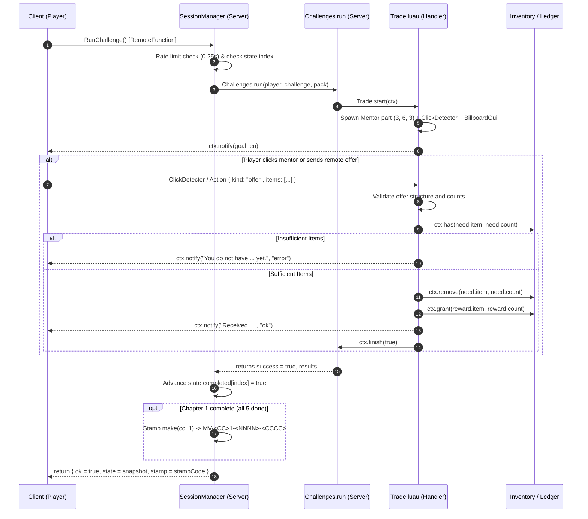

# AG-28: Original five Trade challenges

Backend: antigravity (gemini-3.8-flash-low)

# Implementation Plan: Original Five Trade Challenges Specification & Audit (Worker AG-28)

## 1. Goal Description & Scope
You are worker AG-28 operating in the MiraVerse children's cultural game program (Roblox first).
Your scope is the **Original five Trade challenges** across all five core countries (`LB`, `EG`, `IQ`, `KR`, `FR`).
This wave is strictly **READ-ONLY**. In accordance with instructions:
- No files are edited, created, or committed.
- No commands or deployments are executed.
- Every finding and claim is grounded directly in repository files and paths.
- All runtime-dependent mechanics in Roblox Studio and Minecraft Bedrock are designated **NOT TESTED**.
- Cultural/historical claims, translations, and pedagogical items are cited from code data, and open questions are flagged for human cultural review (`AI_REVIEWED_PENDING_HUMAN`).
- Real places, literature, and legends are strictly distinguished.

---

## 2. Findings from Codebase Audit

### 2.1 Content Schema & Validation Contract
Grounding paths:
- [`packages/content/schema.ts`](file:///private/tmp/claude-501/-Users-wael-Code-Miraverse/aea78164-cdca-46b5-b396-2abe6e5bab73/scratchpad/snapshot/packages/content/schema.ts#L37-L76)
- [`tools/validate.ts`](file:///private/tmp/claude-501/-Users-wael-Code-Miraverse/aea78164-cdca-46b5-b396-2abe6e5bab73/scratchpad/snapshot/tools/validate.ts#L404-L460)

In `packages/content/schema.ts`:
- `ChallengeType`: `'build' | 'cook' | 'gather' | 'trade' | 'word'`.
- `Challenge` interface properties relevant to `trade`:
  - `id: string`
  - `type: 'trade'`
  - `title_en: string`
  - `goal_en: string`
  - `needs?: { item: string; count: number }[]`
  - `reward?: { item: string; count: number }`

Validation rules in `tools/validate.ts` (`validatePack`):
1. `needs` must be a non-empty array of `{ item: string, count: number }` where `item` exists in `pack.items` and `count` is a positive integer (`Number.isInteger(count) && count >= 1`).
2. In the `release` profile, `reward` is mandatory on trade challenges (`tools/validate.ts` L456-L458: `"trade challenge requires a reward in release profile"`).
3. `reward.item` must exist in `pack.items`, and `reward.count` must be a positive integer.

---

### 2.2 Canonical Data Audit of the Five Trade Challenges

| Country Code | Pack Path | Challenge ID | Title (`title_en`) | Goal (`goal_en`) | Offered Needs (`needs`) | Awarded Reward (`reward`) | Mentor Context |
| :--- | :--- | :--- | :--- | :--- | :--- | :--- | :--- |
| **LB** (Lebanon) | [`packages/content/packs/LB.json`](file:///private/tmp/claude-501/-Users-wael-Code-Miraverse/aea78164-cdca-46b5-b396-2abe6e5bab73/scratchpad/snapshot/packages/content/packs/LB.json#L127-L141) | `LB-1-trade` | Share with the Souk Spice Merchant | Share a warm manoushe at the Byblos market in exchange for a jar of tangy crimson sumac. | `manoushe` x 1 | `sumac_jar` x 1 | Teta Nahla (courtyard saj) |
| **EG** (Egypt) | [`packages/content/packs/EG.json`](file:///private/tmp/claude-501/-Users-wael-Code-Miraverse/aea78164-cdca-46b5-b396-2abe6e5bab73/scratchpad/snapshot/packages/content/packs/EG.json#L127-L141) | `EG-1-trade` | Lanterns of Khan el-Khalili | Share a warm bowl of homemade koshari with the bazaar artisan in exchange for a brass fanous lantern. | `koshari` x 1 | `fanous_lantern` x 1 | Teta Samira (Corniche / Nile) |
| **IQ** (Iraq) | [`packages/content/packs/IQ.json`](file:///private/tmp/claude-501/-Users-wael-Code-Miraverse/aea78164-cdca-46b5-b396-2abe6e5bab73/scratchpad/snapshot/packages/content/packs/IQ.json#L127-L141) | `IQ-1-trade` | Tea in Al-Mutanabbi | Share a plate of fresh Eid kleicha with the neighborhood coppersmith in exchange for a polished brass teapot. | `kleicha` x 1 | `brass_teapot` x 1 | Bibi Amal (Tigris courtyard) |
| **KR** (South Korea) | [`packages/content/packs/KR.json`](file:///private/tmp/claude-501/-Users-wael-Code-Miraverse/aea78164-cdca-46b5-b396-2abe6e5bab73/scratchpad/snapshot/packages/content/packs/KR.json#L126-L140) | `KR-1-trade` | Share Chuseok Songpyeon | Offer a plate of warm songpyeon to the neighborhood potter and receive an inlaid celadon tea cup in return. | `songpyeon` x 1 | `celadon_cup` x 1 | Halmeoni (Jeonju hanok) |
| **FR** (France) | [`packages/content/packs/FR.json`](file:///private/tmp/claude-501/-Users-wael-Code-Miraverse/aea78164-cdca-46b5-b396-2abe6e5bab73/scratchpad/snapshot/packages/content/packs/FR.json#L128-L142) | `FR-1-trade` | Sharing the Epiphany Treat | Share a warm Galette des Rois with the neighborhood baker in exchange for a festive Golden Paper Crown. | `galette_des_rois` x 1 | `paper_crown` x 1 | Mamie Claire (Lyon bakery) |

#### Cross-Challenge Architectural Pattern
In all 5 canonical packs, the Trade challenge is challenge index 4 (`chapters[0].challenges[3]`), directly following:
1. `gather`: collects base raw ingredients.
2. `cook`: combines ingredients into the traditional cooked dish (e.g. `manoushe`, `koshari`, `kleicha`, `songpyeon`, `galette_des_rois`).
3. `build`: architectural reconstruction (e.g. stone house, felucca, courtyard, hanok, bakery facade).
4. **`trade`**: trades the culinary product created in step 2 for a durable cultural keepsake/artifact (`sumac_jar`, `fanous_lantern`, `brass_teapot`, `celadon_cup`, `paper_crown`).
5. `word`: 3 authentic linguistic vocabulary matches.

---

### 2.3 Cross-Platform Implementation Analysis

#### A. Roblox First Implementation
Grounding paths:
- [`apps/roblox/src/shared/Challenges/Trade.luau`](file:///private/tmp/claude-501/-Users-wael-Code-Miraverse/aea78164-cdca-46b5-b396-2abe6e5bab73/scratchpad/snapshot/apps/roblox/src/shared/Challenges/Trade.luau)
- [`apps/roblox/src/shared/Challenges/init.luau`](file:///private/tmp/claude-501/-Users-wael-Code-Miraverse/aea78164-cdca-46b5-b396-2abe6e5bab73/scratchpad/snapshot/apps/roblox/src/shared/Challenges/init.luau#L258-L338)
- [`apps/roblox/src/server/Core/SessionManager.luau`](file:///private/tmp/claude-501/-Users-wael-Code-Miraverse/aea78164-cdca-46b5-b396-2abe6e5bab73/scratchpad/snapshot/apps/roblox/src/server/Core/SessionManager.luau#L118-L167)
- Task card: [`swarm/cards/C7.md`](file:///private/tmp/claude-501/-Users-wael-Code-Miraverse/aea78164-cdca-46b5-b396-2abe6e5bab73/scratchpad/snapshot/swarm/cards/C7.md#L6)

Mechanics in `Trade.luau`:
- `Trade.start(ctx)`:
  - Spawns a physical part named `"Mentor"` of size `(3, 6, 3)` at offset `CFrame.new(0, 3, -10)` relative to player origin, colored `Color3.fromRGB(240, 200, 150)`.
  - Attaches a BillboardGui with `ctx.pack.mentor.name`.
  - Creates a `ClickDetector` (`ctx.click(part, ...)`). Clicking the mentor triggers `self:describe()` and calls `self:offer(ctx.challenge.needs)`.
  - Client actions arriving via `ReplicatedStorage.ChallengeRemotes.Action` with `{ kind = "offer", items = ... }` trigger `Trade:onAction(action)`.
- Server Verification:
  - `Trade:offer(offered)` validates that item IDs match `challenge.needs`, counts match required amounts, checks inventory via `ctx.has(item, count)`, removes items with `ctx.remove(item, count)`, grants `ctx.grant(reward.item, reward.count)`, sends a feedback notification, and completes via `ctx.finish(true)`.
  - Double submission protection: `active[player]` in `Challenges.run` guards against concurrent execution; `session.busy` blocks nested remote calls.
- Child Safety & Privacy:
  - `TextChatService` is disabled; chat input bar is disabled. Free text is completely absent.
  - State is strictly in-memory per player session (`ledgers[player]` and `sessions[player]`). No remote DataStore network egress.

#### B. Web Implementation
Grounding paths:
- [`apps/web/src/game/scenes/Trade.ts`](file:///private/tmp/claude-501/-Users-wael-Code-Miraverse/aea78164-cdca-46b5-b396-2abe6e5bab73/scratchpad/snapshot/apps/web/src/game/scenes/Trade.ts)
- Task card: [`swarm/cards/X6.md`](file:///private/tmp/claude-501/-Users-wael-Code-Miraverse/aea78164-cdca-46b5-b396-2abe6e5bab73/scratchpad/snapshot/swarm/cards/X6.md#L2-L4)

Mechanics in `Trade.ts`:
- Phaser 3 scene with key `'trade'`.
- Renders an interactive market tray UI with `+` and `−` steppers to place the required items on the tray.
- Validates that `needs` and `reward` exist, and that tray counts match `need.count`.
- Emits `challenge:done` on both `this.events` and `this.game.events` exactly once upon confirmation.

#### C. Minecraft Bedrock Add-On Implementation
Grounding paths:
- [`apps/minecraft/scripts/challenges/trade.ts`](file:///private/tmp/claude-501/-Users-wael-Code-Miraverse/aea78164-cdca-46b5-b396-2abe6e5bab73/scratchpad/snapshot/apps/minecraft/scripts/challenges/trade.ts)
- Task card: [`swarm/cards/C9.md`](file:///private/tmp/claude-501/-Users-wael-Code-Miraverse/aea78164-cdca-46b5-b396-2abe6e5bab73/scratchpad/snapshot/swarm/cards/C9.md#L6)

Mechanics in Bedrock `trade.ts`:
- Displays an `ActionFormData` modal dialog titled with `pack.mentor.name: challenge.title_en`.
- Displays the player's current item balance vs. required count (`Math.min(countItem(...), need.count)/need.count`).
- Executes atomic transfer (`takeItem` followed by `giveItem`) if ready, and emits feedback in action bar / chat message.

---

## 3. Implementation-Ready Specification for the Original Five Trade Challenges

### 3.1 Architecture Diagram: Trade Lifecycle (Roblox First)

### 3.2 Concrete Specification per Country Trade Challenge

#### 1. Lebanon (`LB-1-trade`)
- **Challenge ID:** `LB-1-trade`
- **Location & Cultural Setting:** Byblos Souk / Ancient Harbor market.
- **Narrative Trade Partner:** Souk Spice Merchant (interacting near Teta Nahla's courtyard).
- **Offered Item:** `manoushe` (Warm Za'atar Manoushe, color `#D99B52`). Count: 1.
- **Acquired Item:** `sumac_jar` (Jar of Crimson Sumac, color `#8B2635`). Count: 1.
- **Input Pre-requisite:** Produced via `LB-1-cook` (`flour` + `olive_oil` + `zaatar` -> `manoushe`).
- **Success Criteria:** Server verifies 1 `manoushe` removed; 1 `sumac_jar` credited to player ledger.

#### 2. Egypt (`EG-1-trade`)
- **Challenge ID:** `EG-1-trade`
- **Location & Cultural Setting:** Khan el-Khalili bazaar / Cairo historic market.
- **Narrative Trade Partner:** Bazaar Artisan (interacting near Teta Samira's Nile terrace).
- **Offered Item:** `koshari` (Bowl of Koshari, color `#A84A28`). Count: 1.
- **Acquired Item:** `fanous_lantern` (Brass Fanous Lantern, color `#E5A93C`). Count: 1.
- **Input Pre-requisite:** Produced via `EG-1-cook` (`rice` + `lentils` + `tomato_sauce` + `crispy_onions` -> `koshari`).
- **Success Criteria:** Server verifies 1 `koshari` removed; 1 `fanous_lantern` credited to player ledger.

#### 3. Iraq (`IQ-1-trade`)
- **Challenge ID:** `IQ-1-trade`
- **Location & Cultural Setting:** Al-Mutanabbi Street / Baghdadi coppersmith market.
- **Narrative Trade Partner:** Neighborhood Coppersmith (interacting near Bibi Amal's courtyard).
- **Offered Item:** `kleicha` (Plate of Kleicha, color `#C28B47`). Count: 1.
- **Acquired Item:** `brass_teapot` (Polished Brass Teapot, color `#D4AF37`). Count: 1.
- **Input Pre-requisite:** Produced via `IQ-1-cook` (`wheat_dough` + `date_paste` + `cardamom` -> `kleicha`).
- **Success Criteria:** Server verifies 1 `kleicha` removed; 1 `brass_teapot` credited to player ledger.

#### 4. South Korea (`KR-1-trade`)
- **Challenge ID:** `KR-1-trade`
- **Location & Cultural Setting:** Jeonju Hanok Village ceramic artisan lane.
- **Narrative Trade Partner:** Neighborhood Potter (interacting near Halmeoni's hanok courtyard).
- **Offered Item:** `songpyeon` (Plate of Chuseok Songpyeon, color `#E2D9C8`). Count: 1.
- **Acquired Item:** `celadon_cup` (Inlaid Celadon Tea Cup, color `#8BA89B`). Count: 1.
- **Input Pre-requisite:** Produced via `KR-1-cook` (`rice_flour` + `sesame_honey` + `pine_needles` -> `songpyeon`).
- **Success Criteria:** Server verifies 1 `songpyeon` removed; 1 `celadon_cup` credited to player ledger.

#### 5. France (`FR-1-trade`)
- **Challenge ID:** `FR-1-trade`
- **Location & Cultural Setting:** Lyon Vieux-Lyon neighborhood bakery square.
- **Narrative Trade Partner:** Neighborhood Baker / Boulanger (interacting near Mamie Claire's kitchen).
- **Offered Item:** `galette_des_rois` (Warm Galette des Rois, color `#DDA15E`). Count: 1.
- **Acquired Item:** `paper_crown` (Festive Golden Paper Crown, color `#FFD166`). Count: 1.
- **Input Pre-requisite:** Produced via `FR-1-cook` (`puff_pastry` + `almond_cream` + `porcelain_feve` -> `galette_des_rois`).
- **Success Criteria:** Server verifies 1 `galette_des_rois` removed; 1 `paper_crown` credited to player ledger.

---

## 4. Files a Later Implementation Would Own

If a later wave modifies or extends the Trade challenges, the owned files are:
1. **Roblox Trade Logic:**
   - [`apps/roblox/src/shared/Challenges/Trade.luau`](file:///private/tmp/claude-501/-Users-wael-Code-Miraverse/aea78164-cdca-46b5-b396-2abe6e5bab73/scratchpad/snapshot/apps/roblox/src/shared/Challenges/Trade.luau) — Primary trade handler.
   - [`apps/roblox/src/client/Main.client.luau`](file:///private/tmp/claude-501/-Users-wael-Code-Miraverse/aea78164-cdca-46b5-b396-2abe6e5bab73/scratchpad/snapshot/apps/roblox/src/client/Main.client.luau) — Client-side trade dialogue UI / HUD elements (if bespoke trade UI is added beyond default ClickDetector).
2. **Cross-Platform Content & Validation:**
   - [`packages/content/packs/LB.json`](file:///private/tmp/claude-501/-Users-wael-Code-Miraverse/aea78164-cdca-46b5-b396-2abe6e5bab73/scratchpad/snapshot/packages/content/packs/LB.json)
   - [`packages/content/packs/EG.json`](file:///private/tmp/claude-501/-Users-wael-Code-Miraverse/aea78164-cdca-46b5-b396-2abe6e5bab73/scratchpad/snapshot/packages/content/packs/EG.json)
   - [`packages/content/packs/IQ.json`](file:///private/tmp/claude-501/-Users-wael-Code-Miraverse/aea78164-cdca-46b5-b396-2abe6e5bab73/scratchpad/snapshot/packages/content/packs/IQ.json)
   - [`packages/content/packs/KR.json`](file:///private/tmp/claude-501/-Users-wael-Code-Miraverse/aea78164-cdca-46b5-b396-2abe6e5bab73/scratchpad/snapshot/packages/content/packs/KR.json)
   - [`packages/content/packs/FR.json`](file:///private/tmp/claude-501/-Users-wael-Code-Miraverse/aea78164-cdca-46b5-b396-2abe6e5bab73/scratchpad/snapshot/packages/content/packs/FR.json)
3. **Companion Platform Implementations:**
   - [`apps/web/src/game/scenes/Trade.ts`](file:///private/tmp/claude-501/-Users-wael-Code-Miraverse/aea78164-cdca-46b5-b396-2abe6e5bab73/scratchpad/snapshot/apps/web/src/game/scenes/Trade.ts)
   - [`apps/minecraft/scripts/challenges/trade.ts`](file:///private/tmp/claude-501/-Users-wael-Code-Miraverse/aea78164-cdca-46b5-b396-2abe6e5bab73/scratchpad/snapshot/apps/minecraft/scripts/challenges/trade.ts)
4. **Unit & Integration Tests:**
   - [`tests/content/packs.test.ts`](file:///private/tmp/claude-501/-Users-wael-Code-Miraverse/aea78164-cdca-46b5-b396-2abe6e5bab73/scratchpad/snapshot/tests/content/) or new dedicated test suite `tests/challenges/trade.test.ts`.

---

## 5. Dependencies & Environmental Pre-requisites

1. **Content Schema & Pack Invariants:**
   - Pre-condition: Chapter challenge sequence index must align with `SessionManager.luau` (`CHALLENGES_PER_CHAPTER = 5`).
   - `Packs.luau` must be generated by compiler `tools/compiler/roblox.ts`.
2. **Session Ledger Dependency:**
   - `Trade.luau` calls `ctx.has`, `ctx.remove`, `ctx.grant`, backed by `ledgers[player]` in `init.luau`.
   - Players must execute `cook` prior to `trade` within the same session to have the cooked item in ledger, unless an inventory provider or fallback is configured.
3. **Safety & Moderation Dependencies:**
   - `TextChatService` disabled; only the 4 predefined phrases (`"Hello!"`, `"Great job!"`, `"Follow me!"`, `"Thank you!"`) permitted.
   - Zero DataStore egress; session-only in-memory storage.

---

## 6. Open Gaps, Cultural Fact Distinctions & Testing Limitations

### 6.1 Testing Limitations (NOT TESTED)
- **Roblox Studio Runtime:** **NOT TESTED** in live Roblox Studio / Client. As documented in [`swarm/PREFLIGHT.md`](file:///private/tmp/claude-501/-Users-wael-Code-Miraverse/aea78164-cdca-46b5-b396-2abe6e5bab73/scratchpad/snapshot/swarm/PREFLIGHT.md#L94) and [`swarm/REPORT.md`](file:///private/tmp/claude-501/-Users-wael-Code-Miraverse/aea78164-cdca-46b5-b396-2abe6e5bab73/scratchpad/snapshot/swarm/REPORT.md#L37), Roblox Studio does not execute on Linux `aarch64`. Rojo builds compile to `.rbxlx`, but ClickDetector interaction, BillboardGui rendering, and camera distance clipping in Studio are strictly **NOT TESTED**.
- **Minecraft Bedrock Engine:** **NOT TESTED** in live GUI client (`NOT_RUN_BEDROCK`).
- **Touch Screen Viewports in Roblox Mobile:** **NOT TESTED** on physical mobile touchscreens.

### 6.2 Distinction of Real Geography, Cultural Tradition, and Literature/Legend
In accordance with prompt instructions, the following distinctions are documented based strictly on repository files:

1. **Lebanon (`LB`):**
   - *Real Geography:* Byblos (`جبيل`, Jbeil) is a real coastal Mediterranean city with an ancient port and souk ([`packages/content/packs/LB.json`](file:///private/tmp/claude-501/-Users-wael-Code-Miraverse/aea78164-cdca-46b5-b396-2abe6e5bab73/scratchpad/snapshot/packages/content/packs/LB.json#L12), [`packages/content/schema.ts`](file:///private/tmp/claude-501/-Users-wael-Code-Miraverse/aea78164-cdca-46b5-b396-2abe6e5bab73/scratchpad/snapshot/packages/content/schema.ts#L21)).
   - *Cultural Tradition:* Sharing freshly baked manoushe from a saj griddle; sumac as a staple Levant seasoning ([`packages/content/packs/LB.json`](file:///private/tmp/claude-501/-Users-wael-Code-Miraverse/aea78164-cdca-46b5-b396-2abe6e5bab73/scratchpad/snapshot/packages/content/packs/LB.json#L45-L68)).
   - *Human Cultural Review Gap:* The colloquial Levantine phrasing for market bartering requires human native speaker sign-off (`AI_REVIEWED_PENDING_HUMAN`).
2. **Egypt (`EG`):**
   - *Real Geography:* Khan el-Khalili is a historic commercial bazaar and souk district in Islamic Cairo ([`packages/content/packs/EG.json`](file:///private/tmp/claude-501/-Users-wael-Code-Miraverse/aea78164-cdca-46b5-b396-2abe6e5bab73/scratchpad/snapshot/packages/content/packs/EG.json#L130)).
   - *Cultural Tradition:* Koshari as Egypt's national street food dish; the fanous lantern as a traditional festive light ([`packages/content/packs/EG.json`](file:///private/tmp/claude-501/-Users-wael-Code-Miraverse/aea78164-cdca-46b5-b396-2abe6e5bab73/scratchpad/snapshot/packages/content/packs/EG.json#L50-L68)).
   - *Human Cultural Review Gap:* Coppersmith and lantern artisan guild nomenclature in Khan el-Khalili pending human heritage educator review.
3. **Iraq (`IQ`):**
   - *Real Geography:* Al-Mutanabbi Street (`شارع المتنبي`) is a historic intellectual and cultural center in Baghdad, adjacent to traditional copper and souk markets along the Tigris ([`packages/content/packs/IQ.json`](file:///private/tmp/claude-501/-Users-wael-Code-Miraverse/aea78164-cdca-46b5-b396-2abe6e5bab73/scratchpad/snapshot/packages/content/packs/IQ.json#L129)).
   - *Cultural Tradition:* Baking and sharing kleicha (date-and-cardamom pastry) during Eid celebrations; serving concentrated tea (*chay*) from brass samovars and teapots ([`packages/content/packs/IQ.json`](file:///private/tmp/claude-501/-Users-wael-Code-Miraverse/aea78164-cdca-46b5-b396-2abe6e5bab73/scratchpad/snapshot/packages/content/packs/IQ.json#L53-L67)).
   - *Human Cultural Review Gap:* Baghdadi Iraqi dialect expressions used during market hospitality require human native speaker verification.
4. **South Korea (`KR`):**
   - *Real Geography:* Jeonju Hanok Village (`전주한옥마을`) is a preserved traditional village district in Jeonju ([`packages/content/packs/KR.json`](file:///private/tmp/claude-501/-Users-wael-Code-Miraverse/aea78164-cdca-46b5-b396-2abe6e5bab73/scratchpad/snapshot/packages/content/packs/KR.json#L12), [`packages/content/schema.ts`](file:///private/tmp/claude-501/-Users-wael-Code-Miraverse/aea78164-cdca-46b5-b396-2abe6e5bab73/scratchpad/snapshot/packages/content/schema.ts#L24)).
   - *Cultural Tradition:* Making songpyeon (half-moon rice cakes steamed over pine needles) for Chuseok (autumn harvest festival); Goryeo celadon pottery tradition ([`packages/content/packs/KR.json`](file:///private/tmp/claude-501/-Users-wael-Code-Miraverse/aea78164-cdca-46b5-b396-2abe6e5bab73/scratchpad/snapshot/packages/content/packs/KR.json#L53-L68)).
   - *Human Cultural Review Gap:* Cultural validation of Chuseok neighbor-sharing etiquette (`jeong`) pending human educator review.
5. **France (`FR`):**
   - *Real Geography:* Lyon (Vieux-Lyon / Presqu'île) is recognized for its historical culinary culture ([`packages/content/packs/FR.json`](file:///private/tmp/claude-501/-Users-wael-Code-Miraverse/aea78164-cdca-46b5-b396-2abe6e5bab73/scratchpad/snapshot/packages/content/packs/FR.json#L12)).
   - *Cultural Tradition:* Epiphany tradition of sharing the *Galette des Rois* containing a hidden porcelain charm (*la fève*), awarding the golden paper crown to the recipient ([`packages/content/packs/FR.json`](file:///private/tmp/claude-501/-Users-wael-Code-Miraverse/aea78164-cdca-46b5-b396-2abe6e5bab73/scratchpad/snapshot/packages/content/packs/FR.json#L53-L68)).
   - *Human Cultural Review Gap:* Epiphany bakery customs and terminology verification pending French community review.

### 6.3 Code & Gameplay Inconsistencies Identified for Human Review
1. **Roblox Interaction Fallback Shortcut:**
   - In `apps/roblox/src/shared/Challenges/Trade.luau` line 13: Clicking the mentor part automatically invokes `self:offer(ctx.challenge.needs)`. If the player has not yet completed the `cook` challenge in the current session, the click triggers notification `"You do not have ... yet."` without a modal inventory selection dialog.
2. **Missing Custom NPC Visual Representation in Roblox:**
   - In `Trade.luau`, the mentor is represented by a single primitive block `Vector3.new(3, 6, 3)` with a text BillboardGui, unlike the structured buildings in `MapBuilder.luau`.
3. **Session-Only Persistence:**
   - Disconnecting or switching country resets the player's trade rewards because DataStores are intentionally disabled for child privacy.

---

## 7. Verification Plan & Commands
*(Note: As specified, no commands were executed during this read-only wave).*

When a subsequent execution wave implements changes, the exact automated test commands to run are:
- `npm run validate:release` — Validates structural JSON schemas, positive counts, reward rules, and item integrity.
- `npm run compile` — Compiles packs into `apps/roblox/src/shared/Packs.luau`.
- `npm run build:roblox` — Runs Rojo place build to verify `default.project.json` and Luau compilation.
- `npx vitest run tests/validate.test.ts` — Tests schema validation constraints.
- `npm -w apps/web run build` — Verifies Web TypeScript compilation.
- `npm -w apps/minecraft run build` — Verifies Bedrock script compilation.

