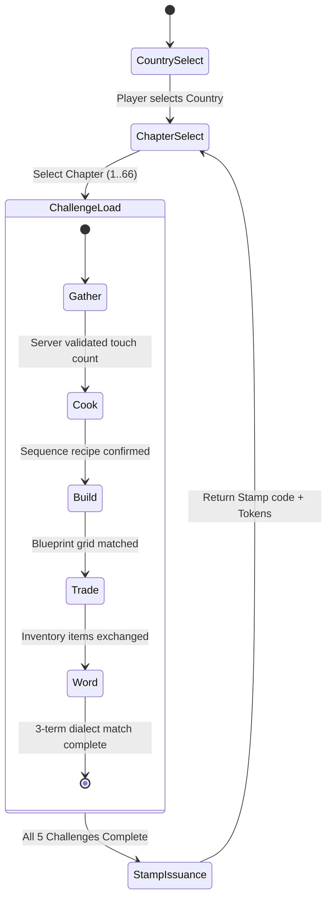

# AG-31: 66 chapters: gameplay flow verification plan

Backend: antigravity (gemini-3.8-flash-low)

# Worker AG-31: 66 Chapters Gameplay Flow Verification Plan

**Role:** AG-31 (MiraVerse Children's Cultural Game Program — Roblox First)  
**Scope:** 66 Chapters: Gameplay Flow Verification Plan  
**Mode:** READ-ONLY Wave (No file edits, commits, or test command runs).  
**Runtime Testing Status:** **NOT TESTED** (No Roblox Studio runtime access; all runtime mechanics, physics, and client-server flows require verification in a live test session).

---

## 1. Executive Summary & Findings

Based on an exhaustive read of repository specifications, contracts, and platform codebases:
1. **Current Codebase vs. Scope Gap**:
   - The current repository models **Chapter 1 across 5 canonical countries** (`LB`, `EG`, `IQ`, `KR`, `FR`), totaling 5 chapters with 5 core challenges each (25 challenges total: `gather`, `cook`, `build`, `trade`, `word`) as documented in [README.md](file:///private/tmp/claude-501/-Users-wael-Code-Miraverse/aea78164-cdca-46b5-b396-2abe6e5bab73/scratchpad/snapshot/README.md#L9-L20) and [packages/content/schema.ts](file:///private/tmp/claude-501/-Users-wael-Code-Miraverse/aea78164-cdca-46b5-b396-2abe6e5bab73/scratchpad/snapshot/packages/content/schema.ts#L4-L87).
   - In [packages/shared/stamp.ts](file:///private/tmp/claude-501/-Users-wael-Code-Miraverse/aea78164-cdca-46b5-b396-2abe6e5bab73/scratchpad/snapshot/packages/shared/stamp.ts#L35-L38), the stamp generator strictly guards:
     ```ts
     if (!['LB', 'EG', 'IQ', 'KR', 'FR'].includes(country) || chapter !== 1) {
       throw new RangeError('Unknown country or unsupported chapter.');
     }
     ```
   - In Roblox Luau ([apps/roblox/src/server/Core/SessionManager.luau](file:///private/tmp/claude-501/-Users-wael-Code-Miraverse/aea78164-cdca-46b5-b396-2abe6e5bab73/scratchpad/snapshot/apps/roblox/src/server/Core/SessionManager.luau#L12-L15) and [apps/roblox/src/server/Core/Stamp.luau](file:///private/tmp/claude-501/-Users-wael-Code-Miraverse/aea78164-cdca-46b5-b396-2abe6e5bab73/scratchpad/snapshot/apps/roblox/src/server/Core/Stamp.luau#L48-L50)), sessions and stamps assume `chapter = 1` and `CHALLENGES_PER_CHAPTER = 5`.
   - Semantic identifiers defined in [packages/contracts/index.ts](file:///private/tmp/claude-501/-Users-wael-Code-Miraverse/aea78164-cdca-46b5-b396-2abe6e5bab73/scratchpad/snapshot/packages/contracts/index.ts#L122-L140) anticipate arbitrary chapters (`/^ch\d+$/`), but no content files currently define chapters 2 through 66.
   - Therefore, scaling to **66 chapters** represents a major architectural expansion of the gameplay progression loop.

2. **Roblox Gameplay Flow Engine Architecture**:
   - **Session Authority**: In [apps/roblox/src/server/Core/SessionManager.luau](file:///private/tmp/claude-501/-Users-wael-Code-Miraverse/aea78164-cdca-46b5-b396-2abe6e5bab73/scratchpad/snapshot/apps/roblox/src/server/Core/SessionManager.luau#L16-L25), player progress is tracked in an in-memory session table (`sessions[Player]`) without persistence (complying with COPPA / GDPR-K local-only policies).
   - **Challenge Sequencing**: In `SessionManager.luau` ([lines 127-167](file:///private/tmp/claude-501/-Users-wael-Code-Miraverse/aea78164-cdca-46b5-b396-2abe6e5bab73/scratchpad/snapshot/apps/roblox/src/server/Core/SessionManager.luau#L127-L167)), challenge indices increment sequentially upon server confirmation:
     `gather -> cook -> build -> trade -> word`.
   - **Challenge Runners**: Handled server-side under [apps/roblox/src/shared/Challenges/](file:///private/tmp/claude-501/-Users-wael-Code-Miraverse/aea78164-cdca-46b5-b396-2abe6e5bab73/scratchpad/snapshot/apps/roblox/src/shared/Challenges/):
     - `Gather.luau`: Physical part touch detection via `Touched` signal.
     - `Cook.luau`: Ordered recipe sequencing with failure reset.
     - `Build.luau`: 2D blueprint grid placement validated against `blueprintLegend`.
     - `Trade.luau`: Item inventory offering and exact requirement check.
     - `Word.luau`: Sequential 3-word vocabulary matching.
   - **Stamp Issuance & Verification**: Completed chapters issue a cryptographic stamp token using FNV-1a 32-bit hash checksum ([apps/roblox/src/server/Core/Stamp.luau](file:///private/tmp/claude-501/-Users-wael-Code-Miraverse/aea78164-cdca-46b5-b396-2abe6e5bab73/scratchpad/snapshot/apps/roblox/src/server/Core/Stamp.luau#L23-L50)).

---

## 2. Implementation-Ready Specification for 66-Chapter Gameplay Flow

### 2.1 Chapter Topology & Semantic ID Architecture
To expand from 5 chapters to 66 chapters, every chapter must conform to the semantic ID schema defined in [packages/contracts/index.ts](file:///private/tmp/claude-501/-Users-wael-Code-Miraverse/aea78164-cdca-46b5-b396-2abe6e5bab73/scratchpad/snapshot/packages/contracts/index.ts#L128-L140):
- **Format**: `<CountryCode>:ch<ChapterNumber>:<QuestSlug>:<ObjectiveSlug>`
- **Chapters 1–66 Distribution**: Must be mapped across canonical country packs (or new country packs if approved by cultural review).
- **Five-Mechanic Arc Standard**: Each chapter must contain exactly 5 challenges in canonical order:
  1. `gather`: Collect raw cultural ingredients/materials.
  2. `cook`: Sequential assembly/recipe crafting step.
  3. `build`: Grid-based architectural blueprint restoration.
  4. `trade`: Barter/exchange with community mentor or artisan.
  5. `word`: 3-term dialect vocabulary recognition step.

### 2.2 Roblox Session State Machine Contract
In [apps/roblox/src/server/Core/SessionManager.luau](file:///private/tmp/claude-501/-Users-wael-Code-Miraverse/aea78164-cdca-46b5-b396-2abe6e5bab73/scratchpad/snapshot/apps/roblox/src/server/Core/SessionManager.luau#L16-L24), the session state must be expanded to support chapter navigation:
```lua
type ChapterProgress = {
    chapterId: number,
    completed: { [number]: boolean },
    isComplete: boolean,
}

type Session = {
    country: string?,
    activeChapter: number, -- 1 to 66
    chapters: { [number]: ChapterProgress },
    stamps: { string },
    stamped: { [string]: boolean }, -- key: cc .. "_" .. chapter
    busy: boolean,
}
```

### 2.3 Verification & Validation State Machine



### 2.4 Test Verification Metrics
1. **Deterministic Progression**: Moving from Challenge 1 to 5 within any chapter $C \in [1, 66]$ must never skip an index or unlock without server authorization.
2. **Re-entrancy & Exploit Prevention**: Rapid invocation of `RunChallenge` RemoteFunction must be blocked by `COOLDOWN = 0.25s` and `s.busy` check.
3. **Child Safety / COPPA Compliance**: No free-text chat input ([apps/roblox/src/client/Main.client.luau](file:///private/tmp/claude-501/-Users-wael-Code-Miraverse/aea78164-cdca-46b5-b396-2abe6e5bab73/scratchpad/snapshot/apps/roblox/src/client/Main.client.luau#L9-L16)); zero off-platform telemetry calls.
4. **Stamp Soundness**: `Stamp.make(country, chapter)` must produce valid codes verified by [packages/shared/stamp.ts](file:///private/tmp/claude-501/-Users-wael-Code-Miraverse/aea78164-cdca-46b5-b396-2abe6e5bab73/scratchpad/snapshot/packages/shared/stamp.ts#L47-L63) and [apps/roblox/src/server/Core/Stamp.luau](file:///private/tmp/claude-501/-Users-wael-Code-Miraverse/aea78164-cdca-46b5-b396-2abe6e5bab73/scratchpad/snapshot/apps/roblox/src/server/Core/Stamp.luau#L48-L63).

---

## 3. Files a Later Implementation Would Own

| Component / Layer | File Path | Scope of Ownership |
| :--- | :--- | :--- |
| **Roblox Server Session** | [apps/roblox/src/server/Core/SessionManager.luau](file:///private/tmp/claude-501/-Users-wael-Code-Miraverse/aea78164-cdca-46b5-b396-2abe6e5bab73/scratchpad/snapshot/apps/roblox/src/server/Core/SessionManager.luau) | Expand `Session` to support multi-chapter progression across 66 chapters, dynamic chapter selection, and per-chapter stamp tracking. |
| **Roblox Server Stamp** | [apps/roblox/src/server/Core/Stamp.luau](file:///private/tmp/claude-501/-Users-wael-Code-Miraverse/aea78164-cdca-46b5-b396-2abe6e5bab73/scratchpad/snapshot/apps/roblox/src/server/Core/Stamp.luau) | Update `Stamp.make` assertion from `chapter == 1` to `chapter >= 1 and chapter <= 66`. |
| **Roblox Client UI** | [apps/roblox/src/client/Main.client.luau](file:///private/tmp/claude-501/-Users-wael-Code-Miraverse/aea78164-cdca-46b5-b396-2abe6e5bab73/scratchpad/snapshot/apps/roblox/src/client/Main.client.luau) | Add chapter selection UI carousel and chapter quest progress display. |
| **Roblox Compiler** | [tools/compiler/roblox.ts](file:///private/tmp/claude-501/-Users-wael-Code-Miraverse/aea78164-cdca-46b5-b396-2abe6e5bab73/scratchpad/snapshot/tools/compiler/roblox.ts) | Ensure compiler serializes all 66 chapters into [apps/roblox/src/shared/Packs.luau](file:///private/tmp/claude-501/-Users-wael-Code-Miraverse/aea78164-cdca-46b5-b396-2abe6e5bab73/scratchpad/snapshot/apps/roblox/src/shared/Packs.luau) without Luau table depth or size budget overruns. |
| **Content Schemas & Packs** | [packages/content/schema.ts](file:///private/tmp/claude-501/-Users-wael-Code-Miraverse/aea78164-cdca-46b5-b396-2abe6e5bab73/scratchpad/snapshot/packages/content/schema.ts), `packages/content/packs/*.json` | Define chapters 2 through 66 with verified cultural artifacts, recipes, and blueprints. |
| **Shared Stamp Contract** | [packages/shared/stamp.ts](file:///private/tmp/claude-501/-Users-wael-Code-Miraverse/aea78164-cdca-46b5-b396-2abe6e5bab73/scratchpad/snapshot/packages/shared/stamp.ts) | Relax `chapter !== 1` restriction in `make()` to accept chapters 1..66. |
| **Content Validator** | [tools/validate.ts](file:///private/tmp/claude-501/-Users-wael-Code-Miraverse/aea78164-cdca-46b5-b396-2abe6e5bab73/scratchpad/snapshot/tools/validate.ts) | Extend `validatePack` to enforce continuity, unique chapter IDs, and recipe/blueprint referential integrity across 66 chapters. |

---

## 4. Dependencies

1. **Upstream Schema & Compiler Pipeline**:
   - `packages/content/schema.ts`: Must formally type chapters 1..66.
   - `tools/compiler/roblox.ts` and `tools/compiler/v04-meta.ts`: Must compile packs to `Packs.luau` and `V04Bundle.luau`.
2. **Cryptographic Consistency Across Languages**:
   - FNV-1a 32-bit checksum in TypeScript ([packages/shared/stamp.ts](file:///private/tmp/claude-501/-Users-wael-Code-Miraverse/aea78164-cdca-46b5-b396-2abe6e5bab73/scratchpad/snapshot/packages/shared/stamp.ts#L17-L33)) and Luau ([apps/roblox/src/server/Core/Stamp.luau](file:///private/tmp/claude-501/-Users-wael-Code-Miraverse/aea78164-cdca-46b5-b396-2abe6e5bab73/scratchpad/snapshot/apps/roblox/src/server/Core/Stamp.luau#L12-L34)) must output identical Base30 stamp codes for every chapter in $1..66$.
3. **Roblox Streaming & Map Assets**:
   - Rojo project configuration ([apps/roblox/default.project.json](file:///private/tmp/claude-501/-Users-wael-Code-Miraverse/aea78164-cdca-46b5-b396-2abe6e5bab73/scratchpad/snapshot/apps/roblox/default.project.json#L26-L31)) enables `StreamingEnabled: true`. World parts spawned by `MapBuilder.luau` must accommodate 66 chapter sites without exceeding spatial collision budgets.

---

## 5. Verification Checklist & Testing Status

| Area | Verification Assertion | Verification Method | Status |
| :--- | :--- | :--- | :--- |
| **Stamp Crypto** | `Stamp.make(cc, ch)` matches golden vector across TS and Luau for $ch \in [1, 66]$ | Unit test in Vitest / Luau test runner | **NOT TESTED** (Read-only mode, no command execution) |
| **Server State** | `SessionManager.runChallenge` increments index sequentially without skipping | Unit mock of `Sessions` | **NOT TESTED** |
| **Rate Limiter** | Rapid clicks on `RunChallenge` / `SelectCountry` reject with `{ ok = false, reason = "slow" }` | Simulated network delay / stress test | **NOT TESTED** |
| **Gather Mechanic** | Touch event registers on server part; verifies player ownership | Roblox Studio simulation | **NOT TESTED** |
| **Cook Mechanic** | Wrong recipe sequence fails and resets step to 0 | Roblox Studio simulation | **NOT TESTED** |
| **Build Mechanic** | Invalid item placement rejected; completing grid triggers finish | Roblox Studio simulation | **NOT TESTED** |
| **Trade Mechanic** | Insufficient item balance denies trade; correct balance grants keepsake | Roblox Studio simulation | **NOT TESTED** |
| **Word Mechanic** | Non-matching vocabulary choice alerts error; 3 correct choices complete quest | Roblox Studio simulation | **NOT TESTED** |
| **Child Safety** | TextChatService and StarterGui chat remain strictly disabled | Client initialization check | **NOT TESTED** |

---

## 6. Open Gaps & Items Requiring Human Cultural Review

> [!IMPORTANT]
> The MiraVerse policy requires that all cultural and historical facts, translations, and pedagogical designs remain grounded in verified source literature and pass human cultural review.

1. **Chapter Distribution Beyond Chapter 1**:
   - The repository currently defines Chapter 1 only for 5 countries: Byblos (`LB`), Cairo (`EG`), Baghdad (`IQ`), Jeonju (`KR`), and Lyon (`FR`).
   - The exact allocation of the remaining 61 chapters (e.g. additional historical eras, regions within the 5 countries, or new countries) is **undefined** in repo files and requires curriculum and human review.
2. **Epistemic Classification (Real vs. Legend vs. Literature)**:
   - For all 66 chapters, every artifact, building, and dialogue node must be categorized into real historical landmarks (e.g. Byblos Crusader Castle, Khan el-Khalili), traditional literary works (e.g. 1001 Nights folklore), or fictional narrative bridges. These distinctions cannot be invented and must be vetted by heritage educators.
3. **Dialect Glosses & Vocabulary Lists**:
   - Each new chapter requires 3–10 vetted dialect terms (with exact Arabic/Korean/French orthography, phonetic transliteration, and age-appropriate child translations).
4. **Third-Party Asset Audit**:
   - All 3D assets and textures must adhere to `CC0-1.0-Procedural-MiraVerse` or `MIT-MiraVerse-Original` licenses ([packages/contracts/index.ts](file:///private/tmp/claude-501/-Users-wael-Code-Miraverse/aea78164-cdca-46b5-b396-2abe6e5bab73/scratchpad/snapshot/packages/contracts/index.ts#L273)). No third-party Roblox marketplace assets may be imported.

